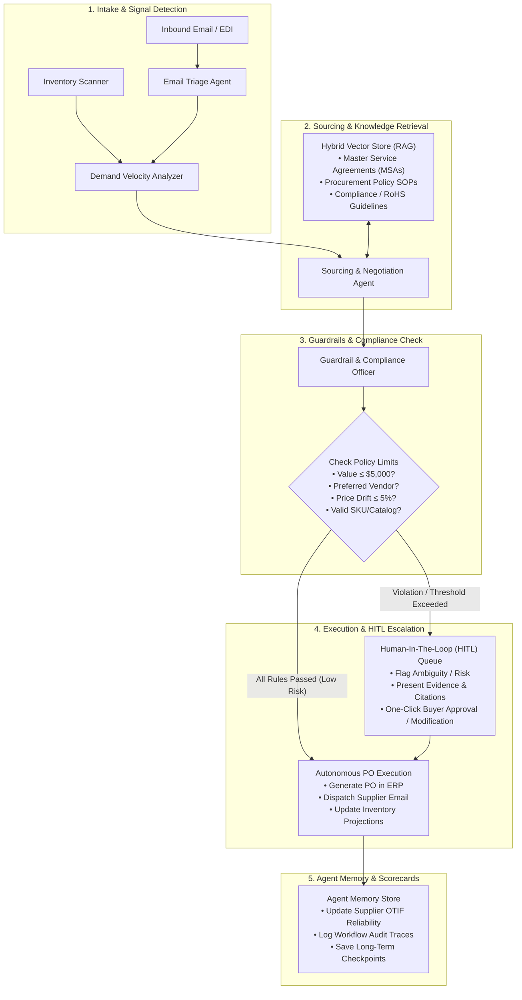

# ProcurePulse AI ⚡
### Production-Grade Autonomous AI Agents & Workflows for Enterprise Supply Chain & Procurement

[](https://fastapi.tiangolo.com)
[](https://github.com/langchain-ai/langgraph)
[](https://python.org)
[](https://docs.pydantic.dev/)
[](https://docker.com)
[](https://pytest.org)

**ProcurePulse AI** is an enterprise-grade agentic platform designed to automate end-to-end supply chain and procurement workflows. It coordinates specialized LLM agents to monitor inbound supplier communications, evaluate real-time inventory signals, optimize supplier sourcing via RAG-indexed contracts, enforce strict financial guardrails, execute autonomous purchase orders, and escalate policy-sensitive decisions to human buyers.

---

## 🏗️ Architecture & Multi-Agent LangGraph Pipeline

The platform uses a state-machine architecture powered by **LangGraph** where agents execute with deterministic guardrails and memory persistence:



---

## ✨ Key Enterprise Capabilities

1. **Inbound Supplier Monitoring & Email Triage Agent**:
   - Parses unstructured supplier emails, PDFs, and order confirmations.
   - Extracts structured entities: Purchase Order numbers, affected SKUs, revised delivery dates, delay durations, and price change notices.
   - Updates purchase order statuses automatically (`ACKNOWLEDGED`, `SHIPMENT_DELAY`) and feeds delay metrics into supplier scorecards.

2. **Inventory & Demand Signals Analysis**:
   - Real-time stock position analysis, burn rate, and days of supply remaining.
   - Automated reorder point (ROP) triggers and safety stock breach warnings.
   - Computes replenishment quantities based on safety stock buffers and lead-time demand.

3. **Tool-Using Autonomous Agents**:
   - Internal API connectors for inventory lookups, catalog queries, PO generation, and email dispatch.
   - Clean microservice separation with SQLAlchemy ORM and schema validation.

4. **Retrieval-Augmented Generation (RAG) & Vector Knowledge Base**:
   - Dense cosine similarity + BM25 keyword hybrid search.
   - Indexed enterprise documentation:
     - `SOP-PROC-001`: Corporate Procurement Policy & Delegation of Authority.
     - `MSA-APEX-2025`: Master Supply Agreement with Apex Electronics (pricing tiers, 5-day lead times, 96% SLA).
     - `MSA-NOVA-2025`: Master Supply Agreement with Nova Packaging Solutions (volume discounts, recycled specs).
     - `MSA-TITAN-2025`: Master Supply Agreement with Titan Fasteners & Hardware (hardware specs, expediting surcharges).
     - `SOP-SC-004`: Stockout Prevention & Critical Replenishment Protocol.
     - `SOP-COMPL-002`: RoHS, REACH, and Conflict Minerals Compliance.

5. **Strict Guardrails & Financial Policy Enforcement**:
   - **Tier 1 (Autonomous Execution)**: ≤ $5,000.00 USD with preferred vendor, price variance ≤ 3%.
   - **Tier 2 (Buyer Approval)**: $5,000.01 – $25,000.00 USD.
   - **Tier 3 (Procurement Manager)**: $25,000.01 – $100,000.00 USD.
   - **Tier 4 (VP Operations)**: > $100,000.00 USD or unapproved/new vendor.
   - **Price Variance Protection**: Any price hike > 5.0% automatically pauses autonomous execution and escalates to human review.

6. **Human-In-The-Loop (HITL) Operations**:
   - Dedicated escalation queue with risk categorization (Low, Medium, High, Critical).
   - Buyer can:
     - **Approve**: Immediately transmits PO to the vendor.
     - **Reject**: Cancels the proposed order.
     - **Modify**: Adjusts quantities or negotiates price before authorizing transmission.

7. **Agent Memory & Supplier Scorecard**:
   - Tracks long-term On-Time In-Full (OTIF) percentages, past delays, and quality defect rates.
   - Re-evaluates supplier composite reliability dynamically based on real fulfillment events.

---

## 🛠️ Tech Stack

| Layer | Technologies |
|---|---|
| **Backend & Microservices** | Python 3.11+, FastAPI, Pydantic v2, SQLAlchemy 2.0, Uvicorn |
| **Agent Orchestration** | LangGraph (StateGraph), LangChain Core |
| **AI / LLM Stack** | Built-in Autonomous Domain Engine (zero-config local run) + OpenAI (`gpt-4o`), Claude (`claude-3-5-sonnet`), and Gemini APIs |
| **RAG & Vector Database** | Hybrid Dense-BM25 vector search with cosine similarity, extensible to pgvector / Chroma |
| **Database & Caching** | SQLite (out-of-the-box local), PostgreSQL 16 + pgvector, Redis |
| **Frontend Dashboard** | HTML5, Tailwind CSS, JavaScript (ES6+), FontAwesome |
| **Testing & Quality** | Pytest, Pytest-Cov, 100% test pass rate |
| **DevOps & Infrastructure** | Docker, Docker Compose, Windows Batch (`start.bat`), Shell script (`start.sh`) |

---

## 🚀 Quick Start Guide

### Option 1: Direct Local Execution (Zero External Dependencies)

1. **Clone and navigate to repository**:
   ```powershell
   cd "c:\Users\vinod\Desktop\ai purchase agent"
   ```

2. **Install dependencies**:
   ```bash
   pip install -r requirements.txt
   ```

3. **Start the application**:
   - On Windows:
     ```powershell
     .\start.bat
     # OR
     python main.py
     ```
   - On Linux/macOS:
     ```bash
     chmod +x start.sh
     ./start.sh
     ```

4. **Access the platform**:
   - **Interactive Web Dashboard**: [http://localhost:8000](http://localhost:8000)
   - **Swagger / OpenAPI Documentation**: [http://localhost:8000/docs](http://localhost:8000/docs)
   - **Redoc Interactive API Specs**: [http://localhost:8000/redoc](http://localhost:8000/redoc)

---

### Option 2: Docker & Docker Compose (Multi-Container Microservices)

Deploy with PostgreSQL (pgvector enabled), Redis, and FastAPI:

```bash
docker-compose up --build -d
```

Verify services:
```bash
docker-compose ps
```

---

## 🧪 Running Automated Tests

Run the complete test suite:
```bash
python -m pytest tests/ -v
```

Output:
```
tests/test_api_endpoints.py::test_api_health PASSED                      [  5%]
tests/test_api_endpoints.py::test_api_get_inventory PASSED               [ 10%]
tests/test_api_endpoints.py::test_api_get_suppliers PASSED               [ 15%]
tests/test_api_endpoints.py::test_api_workflow_run PASSED                [ 21%]
tests/test_api_endpoints.py::test_api_rag_search PASSED                  [ 26%]
tests/test_email_parsing.py::test_email_parsing_order_confirmation PASSED [ 31%]
tests/test_email_parsing.py::test_email_parsing_shipment_delay PASSED    [ 36%]
tests/test_guardrails.py::test_guardrails_low_value_preferred_passes PASSED [ 42%]
tests/test_guardrails.py::test_guardrails_high_value_requires_escalation PASSED [ 47%]
tests/test_guardrails.py::test_guardrails_unapproved_supplier_blocks PASSED [ 52%]
tests/test_guardrails.py::test_guardrails_price_variance_escalation PASSED [ 57%]
tests/test_hitl_workflow.py::test_hitl_escalation_and_approval PASSED    [ 63%]
tests/test_hitl_workflow.py::test_hitl_modification_and_approval PASSED  [ 68%]
tests/test_inventory.py::test_check_inventory_levels PASSED              [ 73%]
tests/test_inventory.py::test_calculate_reorder_requirements PASSED      [ 78%]
tests/test_inventory.py::test_update_inventory_stock PASSED              [ 84%]
tests/test_rag_retrieval.py::test_rag_retrieval_procurement_policy PASSED [ 89%]
tests/test_rag_retrieval.py::test_rag_retrieval_supplier_msa PASSED      [ 94%]
tests/test_rag_retrieval.py::test_rag_dynamic_document_indexing PASSED   [100%]

======================== 19 passed in 0.50s ========================
```

---

## 📡 REST API Reference

| Method | Endpoint | Description |
|---|---|---|
| `GET` | `/api/inventory` | List all tracked inventory items with days of supply & reorder flags |
| `GET` | `/api/inventory/{sku}` | Detailed stock metrics for a single SKU |
| `PUT` | `/api/inventory/{sku}/adjust` | Adjust on-hand inventory levels |
| `GET` | `/api/suppliers` | List approved/preferred suppliers with OTIF reliability scorecards |
| `GET` | `/api/orders` | Query all purchase orders, status, line items, and risk scores |
| `GET` | `/api/approvals` | Fetch Human-In-The-Loop pending escalation queue |
| `POST` | `/api/approvals/{id}/decide` | Submit buyer decision (`APPROVE`, `REJECT`, `MODIFY`) |
| `GET` | `/api/emails` | Inbound and outbound supplier communications log |
| `POST` | `/api/emails/inbound` | Ingest and triage an inbound supplier email |
| `POST` | `/api/rag/search` | Semantic and keyword hybrid search over procurement knowledge base |
| `GET` | `/api/rag/docs` | List all indexed SOPs, contracts, and compliance docs |
| `POST` | `/api/workflow/run` | Trigger autonomous LangGraph procurement workflow |
| `GET` | `/api/audit/logs` | Immutable audit trail of agent reasoning traces and tool calls |

---

## 🛡️ Business Guardrail Configuration

Guardrail parameters can be configured in `.env` or enterprise configuration:

```env
# Maximum purchase order amount the agent can execute without human sign-off
MAX_AUTO_APPROVE_AMOUNT=5000.00

# Manager approval threshold
MANAGER_APPROVAL_THRESHOLD=25000.00

# Maximum allowed price variance before human buyer signoff is triggered
MAX_PRICE_VARIANCE_PERCENT=5.0

# Minimum safety stock buffer days
SAFETY_STOCK_BUFFER_DAYS=14
```

---

## 🔒 Security & Enterprise Readiness

- **Role-Based Financial Authorization**: Hard ceilings preventing automated overspending.
- **Supplier Verification**: Blocks unapproved grey-market suppliers automatically.
- **Hallucination Protection**: Validates every generated line item and price against the active relational catalog before generating records.
- **Deterministic Fallbacks**: If external LLM APIs experience outages, the built-in deterministic reasoning engine takes over without disrupting the workflow.
- **Complete Audit Trail**: Every tool call, agent thought, and decision is written to an immutable audit ledger with unique trace IDs.
